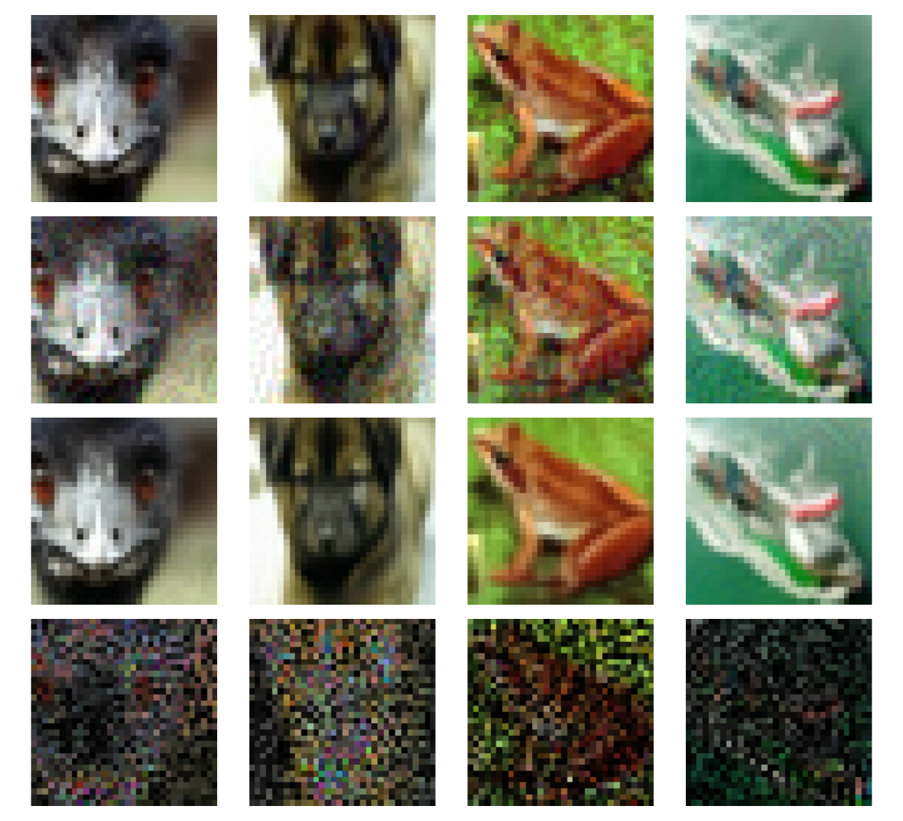
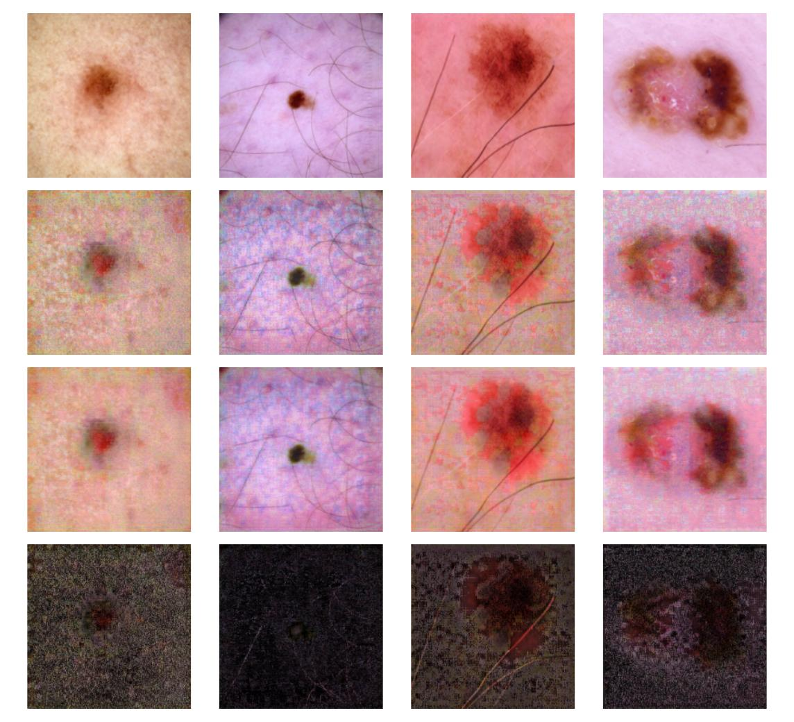
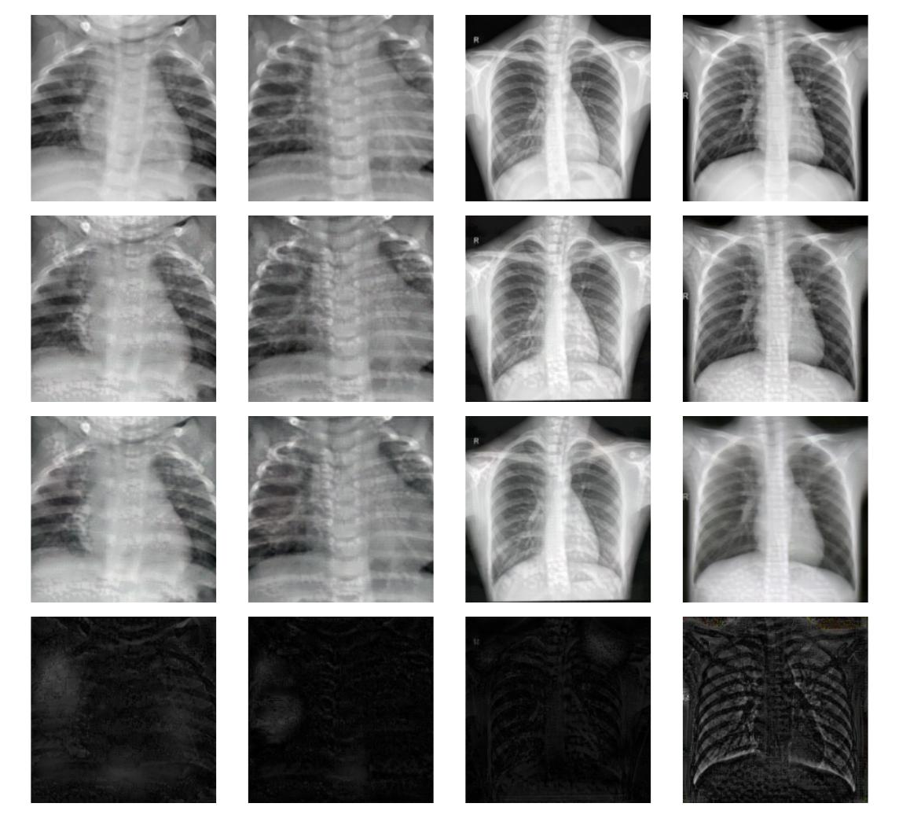

# Score-based Lyapunov Stable Neural ODE for Robust Classification

Code for the paper *Score-based Lyapunov Stable Neural ODE for Robust Classification*.

A pretrained score model defines the vector field ẋ = ∇ log p(x). Integrating this ODE
from a (possibly adversarial) input moves it towards a high-density region, where it is
given to a standard classifier. The density −log p is a Lyapunov function of this flow.

This repository builds on the PyTorch implementation of
[Score-Based Generative Modeling through SDEs](https://github.com/yang-song/score_sde_pytorch)
(Song et al., ICLR 2021), released under the Apache License 2.0. See `NOTICE`.

## Installation

```bash
python -m venv .venv && source .venv/bin/activate
pip install -r requirements.txt
pip install git+https://github.com/fra31/auto-attack
```

## Layout

| Path | Content |
|---|---|
| `training/score_training/` | Score model training (`main.py`, `run_lib.py`, `losses.py`, `sde_lib.py`) |
| `training/classifier_training/` | Classifier training |
| `models/` | Score networks (NCSN++, DDPM) and classifiers |
| `configs/` | Score model configurations |
| `my_datasets/` | Dataset loading (CIFAR-10, MNIST, DermaMNIST, PneumoniaMNIST) |
| `evaluate.py` | Evaluation of the composed model (ODE + classifier) under attack |
| `global.py` | Neural ODE followed by a classifier, with FGSM |
| `train_cifar_classifier.py` | Classifier training script (ResNet-18) |

## Pretrained score models

For CIFAR-10 we use the pretrained score models released by Song et al. for
[score_sde_pytorch](https://github.com/yang-song/score_sde_pytorch). All of their checkpoints are in
[this Google Drive folder](https://drive.google.com/drive/folders/1tFmF_uh57O6lx9ggtZT_5LdonVK2cV-e?usp=sharing).
The two we use are:

| Config | Checkpoint folder |
|---|---|
| `configs/score_configs/ve/cifar10_ncsnpp_continuous.py` | [`ve/cifar10_ncsnpp_continuous/`](https://drive.google.com/drive/folders/1b0gy_LLgO_DaQBgoWXwlVnL_rcAUgREh?usp=sharing) |
| `configs/score_configs/ve/cifar10_ncsnpp_deep_continuous.py` | [`ve/cifar10_ncsnpp_deep_continuous/`](https://drive.google.com/drive/folders/11s6A_xM7qiztdj8AHQWqaIAUSC3I7uX2?usp=sharing) |

Download the `.pth` file from the folder, save it for instance as `checkpoints/score_cifar10_ncsnpp_deep_cont.pth`
and pass it to `evaluate.py` with `--score_ckpt`. The configuration given with `--score_config` must match the checkpoint.

For DermaMNIST and PneumoniaMNIST we train the score model ourselves with
`training/score_training/main.py` (configs `dermamnist_ncsnpp_continuous_*.py` and `pneumonia_256_ncsnpp_continuous.py`).
These checkpoints are not included in the repository.

## Usage

**1. Train a score model** (from the repository root):

```bash
python training/score_training/main.py \
  --config configs/score_configs/ve/cifar10_ncsnpp_continuous.py \
  --workdir exp/cifar10_ncsnpp --mode train
```

**2. Train a classifier:**

```bash
python train_cifar_classifier.py --dataset cifar10 --mode full --epochs 100 \
  --batch-size 256 --out cifar10_resnet18_ckpt.pth
```

**3. Evaluate the composed model under attack:**

```bash
python evaluate.py \
  --dataset cifar10 --classifier resnet18 \
  --classifier_ckpt cifar10_resnet18_ckpt.pth \
  --score_ckpt exp/cifar10_ncsnpp/checkpoints/checkpoint.pth \
  --score_config configs.score_configs.ve.cifar10_ncsnpp_continuous \
  --attack autoattack --eps 0.03137 --n_samples 500
```

Main options of `evaluate.py`: `--sigma`, `--t_noise` (noise level before the flow),
`--ode_T` (integration time), `--attack`, `--eps`, `--batch_size`, `--n_samples`.

Datasets are downloaded to `data/` on first use. Checkpoints are not included in the
repository.

## Qualitative results

Each figure shows, from top to bottom, the clean images, the images perturbed by an FGSM attack
(ε = 0.031), the images corrected by the score flow, and the residuals.

**CIFAR-10**



**DermaMNIST**



**PneumoniaMNIST**



## Citation

```bibtex
@article{jarraya2026lyapunov,
  title   = {Score-based Lyapunov Stable Neural {ODE} for Robust Classification},
  author  = {Jarraya, Zakaria},
  year    = {2026}
}
```

## License

Apache License 2.0, see `LICENSE`. Parts of the code originate from
[score_sde_pytorch](https://github.com/yang-song/score_sde_pytorch) (Copyright 2020 The Google Research Authors).
